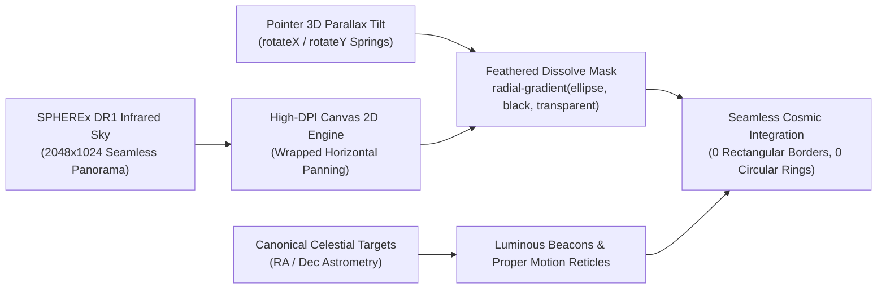

# SPHEREx HORIZON — Explorer Astronomical Window Visualization

## Overview

The Chapter 02 (Explorer) showcase features an authentic, immersive **Celestial Window Panorama** (`frontend/src/components/showcase/ExplorerShowcaseVisual.tsx`). It replaces the legacy 3D celestial sphere with an art-directed window opening into the real infrared universe, seamlessly dissolving into the surrounding cosmic starfield without artificial planet-like shadows, circular outlines, or patchwork boundaries.

---

## 1. Technical Investigation: Root Cause of Previous Sphere Artifacts

During the earlier 3D globe experiment, the celestial sphere displayed prominent triangular patches, brightness discontinuities, and texture seams:

1. **HEALPix Order 0 Diamond Boundaries:** The SPHEREx all-sky survey tiles in `backend/data/cache/hips` are organized in the HEALPix tessellation hierarchy. At Order 0, the entire sky is partitioned into 12 base curvilinear diamonds ($N_{\text{side}}=512$).
2. **Indexed Palette Interpolation:** Re-projecting 8-bit indexed colormap PNG tiles (`mode: P`) across spherical coordinates produced sharp discontinuities along the 12 base diamond boundaries, appearing as triangular patchwork facets when wrapped on a Three.js `SphereGeometry`.
3. **Artificial Globe Aesthetic:** Presenting an all-sky infrared celestial map as a physical spinning globe created an artificial planet-like shadow and dark sphere look, conflicting with the feeling of peering outward into deep space.

---

## 2. Architecture of the Celestial Window Panorama

### Key Technical Achievements
- **Seamless Feathered Dissolve Mask:** The celestial window uses an elliptical feathered alpha mask (`mask-image: radial-gradient(ellipse 88% 80% at 50% 50%, black 52%, transparent 98%)`), smoothly blending its boundaries into the deep cosmic backdrop without rectangular cards or thick circular borders.
- **Pointer-Responsive 3D Parallax Tilt:** User pointer movement triggers subtle 3D perspective tilt (`perspective: 1200px`, `rotateX: -4.5°..+4.5°`, `rotateY: -6.5°..+6.5°`), providing depth and spatial immersion.
- **Draggable Celestial Panning:** Users can click and drag horizontally across all 24 hours of Right Ascension. Idle drift automatically advances the panorama when not interacting.
- **Equatorial Coordinate Grid:** Coordinate meridians and parallels are projected with precision: Celestial Equator at $\text{Dec} = 0^\circ$ in warm luminous gold (`#F4A272`), Declination parallels ($\pm 30^\circ, \pm 60^\circ$), and the Ecliptic Plane tilted at $23.44^\circ$ in cyan/indigo.
- **Canonical Target Beacons:** Five canonical science targets (Barnard's Star, WISE 0855, Epsilon Indi B, RW Aurigae, R Draconis) are positioned at their exact celestial coordinates with proper motion drift vectors and interactive HUD inspection cards.

---

## 3. Interactive Action Previews

- **Explore the Sky (Default):** Displays the full composite infrared sky panorama, active coordinate meridians, and a subtle non-blocking caption (`SPHEREx DR1 · 102-Band Infrared All-Sky Panorama · Drag to Explore`).
- **Explore Objects:** The panorama automatically glides and centers on Barnard's Star ($\text{RA} = 269.45^\circ$, $\text{Dec} = +4.74^\circ$), illuminates targeting reticles, and displays an astrophysical card with verified proper-motion rate ($\mu = 10.39''/\text{yr}$) and baseline displacement ($10.223''$).
- **Explore the Spectrum:** Renders a multi-wavelength comparative inspection layer, cycling through authentic SPHEREx infrared channels ($0.75\ \mu\text{m} \to 1.33\ \mu\text{m} \to 2.36\ \mu\text{m} \to 4.72\ \mu\text{m}$) with interactive wavelength chips.
