# SPHEREx HORIZON — Complete Project Audit, Scientific Verification & Feature Checklist

**Audit Date:** November 14, 2026  
**Auditor Roles:** Senior Software Architect, Scientific Data Engineer, Astronomy Application Reviewer, Frontend UX Reviewer, Quality Assurance Engineer  
**Project:** SPHEREx HORIZON — Interactive Cosmic Discovery Platform  
**Team:** Meteor Rizzlers  
**Competition:** NASA Space Apps Challenge 2026  
**Challenge:** Planet X and SPHEREx  
**Repository Location:** `c:\Users\lenovo\OneDrive\Desktop\NASA\nasa-sphere`  

---

# 1. EXECUTIVE SUMMARY

### 1.1 What the Application Currently Is
SPHEREx HORIZON is a full-stack astronomical citizen-science web platform designed to explore infrared sky surveys from NASA's SPHEREx (*Spectro-Photometer for the History of the Universe, Epoch of Reionization and Ices Explorer*) mission. The application features a React 19 + TypeScript frontend with an astronomical dark visual identity and a Python FastAPI backend leveraging Astropy, Photutils, Reproject, and PyVO.

### 1.2 What Has Actually Been Implemented
1. **Live Archive Connectivity:** The backend connects to the official NASA/IPAC Infrared Science Archive (IRSA) TAP service (`https://irsa.ipac.caltech.edu/TAP`, table `spherex.obscore`). It performs live IVOA ADQL cone searches, retrieves authentic SPHEREx Quick Release 3 (`spherex_qr3`) and Data Release 1 (`spherex_dr1`) observation metadata, and resolves DataLink URLs to authentic 60.1 MB Level 2 FITS products.
2. **Astronomical FITS & WCS Processing Engine:** A fully operational FITS ingestion pipeline exists in `fits_service.py` and `image_processing_service.py`. It reads Multi-Extension FITS files (`PRIMARY`, `IMAGE`, `FLAGS`, `VARIANCE`, `ZODI`, `EPSF`, `WCS-WAVE`), parses celestial tangential-SIP WCS, executes sub-milliarcsecond coordinate roundtrips ($3.63 \times 10^{-9}$ arcseconds error), extracts centered 2D spatial cutouts using Astropy `Cutout2D`, and normalizes float32 flux arrays with astronomical Asinh stretches.
3. **Interactive Sky Atlas:** Integrated CDS Aladin Lite v3 on the `/explore` page with optical (DSS2 Color), near-infrared (2MASS Color), and mid-infrared (AllWISE Color) hierarchical survey layers, live target HUD, and an offline astronomical name resolver with SIMBAD fallback.
4. **Target Database & Curated Literature Catalogs:** Instant resolution for challenge targets (Barnard's Star, WISE 0855, Epsilon Indi B, RW Aurigae, R Draconis) and 50+ calibration stars, alongside curated cross-mission astrometry from Gaia DR3, AllWISE photometry, and SIMBAD literature citations.
5. **Interactive UI Workspaces & Educational Modules:** Time Machine comparator, Discovery Lab with co-addition stacking controls, Spectral Explorer with 102 near-IR channels and molecular absorption tags ($H_2O$, $CO_2$, $CO$, $Pa\text{-}\beta$), 3 interactive guided citizen-science missions with quizzes, and a persistent Discovery Journal with reproducible Markdown report export.

### 1.3 Whether the Application Runs
- **Frontend:** **RUNS SUCCESSFULLY.** Builds cleanly with Vite (`tsc -b && vite build`: 1620 modules transformed in 3.77s, 0 errors). Development server starts cleanly on `http://localhost:5173/` and communicates with the backend via Vite reverse proxy.
- **Backend:** **RUNS SUCCESSFULLY** after installing missing dependencies (`requests`, `pyvo`, `astroquery`). Automated test suite (`pytest tests/`) executes with 5 out of 5 tests passing in 2.68s. Uvicorn server runs on `http://127.0.0.1:8000/`.
- **Public Access:** Accessible 100% without user authentication or API paywalls.

### 1.4 The Critical Scientific Disconnect: Real Data Ingestion vs. Mock Visualizers
While the data ingestion pipeline queries real NASA/IPAC IRSA observation metadata and downloads genuine 60 MB FITS images, **the image visualization and time-domain comparison endpoints (`/api/processing/preview`, `/api/processing/stack`, `/api/comparison/align`) are disconnected from the downloaded FITS files.** 
Instead of extracting cutouts from downloaded FITS files, these endpoints generate **synthetic 256x256 2D Gaussian point spread functions using `np.random.normal()`** and simulate proper motion by hardcoding pixel shifts (`shift_x = 4.2`, `shift_y = 3.5`). Consequently:
- The Time Machine displays synthetic Gaussian PSFs rather than real FITS cutouts.
- The Discovery Lab detects proper motion of $34.27''$ across a 57-day baseline for Barnard's Star (physically, Barnard's Star moves only $\sim 1.6''$ in 57 days).
- The Spectral Lab computes continuum bars using a mathematical Gaussian formula (`Math.exp(-((wl - 1.4)**2) / 0.8)`) rather than extracting calibrated flux from SPHEREx spectral cubes.
- The photometric light curves for R Draconis and RW Aurigae are hardcoded static data dictionaries.

### 1.5 Overall Engineering Readiness Score
**61 / 100** — *Needs Critical Fixes Before Demonstration.* (See Section 17 for detailed point allocation).

---

# 2. REPOSITORY ARCHITECTURE & INVENTORY

## 2.1 Technology Stack Summary
- **Frontend Framework:** React 19.0.0, TypeScript 5.6.2, Vite 6.0.5, Tailwind CSS 3.4.17.
- **Routing & State:** React Router v7.18.5, LocalStorage, React Hooks.
- **Charts & Graphics:** Recharts 2.15.4, Lucide React 0.469.0, HTML5 Canvas Starfield.
- **Sky Visualization:** CDS Strasbourg Aladin Lite v3 (dynamically loaded from `https://aladin.cds.unistra.fr/AladinLite/api/v3/latest/aladin.js`).
- **Backend Framework:** FastAPI 0.162.5, Uvicorn 0.54.0, Pydantic 2.14.3, Starlette 1.7.0.
- **Scientific Python Libraries:** Astropy 6.1.7, Photutils 2.0.2, Reproject 0.14.1, PyVO 1.10.0, Astroquery 0.4.11, SciPy 1.15.3, NumPy 2.2.6, Matplotlib 3.10.9.
- **External Archives:** NASA/IPAC IRSA TAP (`spherex.obscore`), IRSA DataLink, IRSA IBE FITS Server, CDS Sesame/SIMBAD.
- **Storage:** Local filesystem directories (`backend/data/cache/fits/`, `backend/data/cache/queries/`, `backend/data/discoveries.json`).

## 2.2 Repository Architecture Diagram

```mermaid
flowchart TD
    subgraph Client["Frontend Client (React 19 + TypeScript + Vite :5173)"]
        UI_Home["/ (Home Hero & Stats)"]
        UI_Explore["/explore (Aladin Lite v3 Sky Atlas)"]
        UI_Objects["/objects & /objects/:id (Target Detail)"]
        UI_Time["/time-machine (Blink / Slider / Diff)"]
        UI_Lab["/discovery-lab (DAOStarFinder & Stacking)"]
        UI_Spec["/spectra (102 LVF Channels)"]
        UI_LC["/light-curves (Photometric Time-Series)"]
        UI_Miss["/missions (Guided Citizen Missions)"]
        UI_Disc["/discoveries (Journal & Report Export)"]
        API_Client["services/api.ts (Typed HTTP Client)"]
    end

    subgraph Server["FastAPI Backend (:8000)"]
        Main["app/main.py (CORS, Router Hub)"]
        R_Arch["routers/archive.py"]
        R_Obs["routers/observations.py"]
        R_Proc["routers/processing.py"]
        R_Comp["routers/comparison.py"]
        R_Spec["routers/spectra.py"]
        R_LC["routers/lightcurves.py"]
        R_Cat["routers/catalogs.py"]
        R_Disc["routers/discoveries.py"]
        R_Miss["routers/missions.py"]
        R_Assist["routers/assistant.py"]
    end

    subgraph ScientificServices["Core Scientific Services"]
        S_IRSA["irsa_service.py (PyVO TAP spherex.obscore)"]
        S_FITS["fits_service.py (Astropy FITS & WCS)"]
        S_Proc["image_processing_service.py (Asinh & Cutouts)"]
        S_Diff["difference_service.py (DAOStarFinder)"]
        S_Align["alignment_service.py (Reproject Interp)"]
        S_Coord["coordinate_service.py (SkyCoord & Offline Catalog)"]
        S_Spec["spectral_service.py (102 LVF Bands)"]
        S_LC["lightcurve_service.py (Static Time-Series)"]
        S_Cat["catalog_service.py (Gaia DR3 / AllWISE)"]
    end

    subgraph External["External Astronomical Services"]
        EXT_TAP["NASA/IPAC IRSA TAP (spherex.obscore)"]
        EXT_DL["NASA/IPAC IRSA DataLink Service"]
        EXT_FITS["NASA/IPAC IBE FITS Server (60 MB)"]
        EXT_CDS["CDS Aladin Lite & SIMBAD"]
    end

    subgraph LocalStorage["Local Caching & Journal"]
        C_FITS["data/cache/fits/*.fits"]
        C_QRY["data/cache/queries/*.json"]
        C_JRN["data/discoveries.json"]
    end

    UI_Explore --> EXT_CDS
    Client -->|HTTP Proxy /api| Main
    Main --> R_Obs & R_Arch & R_Proc & R_Comp & R_Spec & R_LC & R_Cat & R_Disc & R_Miss & R_Assist
    R_Obs & R_Arch --> S_IRSA
    S_IRSA -->|IVOA ADQL| EXT_TAP
    S_IRSA -->|Resolve URL| EXT_DL
    S_IRSA --> C_QRY
    S_FITS -->|Download FITS| EXT_FITS
    EXT_FITS --> C_FITS
    R_Disc --> C_JRN
    R_Proc -.->|MOCK Gaussian PSF| S_Proc
    R_Comp -.->|MOCK Shifted Array| S_Diff
    S_Diff --> S_Proc
```



## 2.3 Complete Inventory of Application Routes & Pages

| Route | Page Component | Implemented Functionality | Genuine vs Mock Status |
|---|---|---|---|
| `/` | `Home.tsx` | Hero title, mission statistics, live telescope preview widget, how-it-works cards, target carousel. | **PARTIAL** (Preview is synthetic Gaussian PSF). |
| `/explore` | `ExploreSky.tsx` | Aladin Lite v3 all-sky map, DSS2/2MASS/AllWISE layers, name search, quick jump, fallback HUD. | **PASS** (Genuine CDS sky atlas & coordinates). |
| `/objects` | `ObjectExplorer.tsx` | Target search by name, type filter (Red Dwarf, Brown Dwarf, etc.), target cards. | **PASS** (Target search and navigation operational). |
| `/objects/:objectId` | `ObjectDetail.tsx` | Coordinates display, Asinh preview, Observations tab (IRSA data), Spectra tab, Catalogs tab. | **PARTIAL** (Observations tab = PASS; Preview = MOCK; Spectra = MOCK). |
| `/time-machine` | `TimeMachine.tsx` | Side-by-Side, Split Slider, Blink Comparator (1-4 Hz), Difference Image, candidate list. | **MOCK** (Displays synthetic Gaussian PSFs, not real FITS). |
| `/discovery-lab` | `DiscoveryLab.tsx` | DAOStarFinder detection, multi-exposure stacking engine, journal logger form. | **MOCK** (DAOStarFinder runs on synthetic array; stacking is synthetic). |
| `/spectra` | `SpectralExplorer.tsx` | 102 LVF channels across D1–D6, molecular markers ($H_2O, CO_2, CO, Pa\text{-}\beta$). | **MOCK** (Relative flux curve generated by mathematical formula). |
| `/light-curves` | `LightCurves.tsx` | Photometric time-series charts, phase folding ($0.0 \to 1.0$), error bars for 4 targets. | **MOCK** (Hardcoded static data dictionaries in Python service). |
| `/missions` | `Missions.tsx` | Guided citizen missions (Barnard's Star, WISE 0855, RW Aurigae), step-by-step quiz. | **PASS** (Educational citizen-science workflow functional). |
| `/discoveries` | `MyDiscoveries.tsx` | Journal of saved candidate detections, deletion, export report to Markdown (`.md`). | **PASS** (Persistent local JSON storage and export operational). |
| `/about` | `About.tsx` | Mission attribution, instrument specs, IRSA and Space Apps Challenge details. | **PASS** (Documentation & attribution complete). |
| `/settings` | `Settings.tsx` | Application settings placeholder. | **PASS** (Static configuration interface). |

## 2.4 Complete Inventory of Backend API Endpoints

| HTTP Method | Endpoint | Handler File | Implementation Summary | Verified Status |
|---|---|---|---|---|
| `GET` | `/api/health` | `main.py` | Health check returning service status, archive endpoint, cache directory. | **PASS** (200 OK) |
| `GET` | `/` | `main.py` | Root greeting and documentation links. | **PASS** (200 OK) |
| `GET` | `/api/objects` | `routers/objects.py` | Returns curated challenge objects list. | **PASS** (200 OK) |
| `GET` | `/api/objects/{object_id}` | `routers/objects.py` | Returns detail metadata for specified object. | **PASS** (200 OK) |
| `GET` | `/api/objects/resolve/{query}` | `routers/objects.py` | Resolves target name or coordinates using offline catalog and SIMBAD. | **PASS** (200 OK) |
| `GET` | `/api/archive/search` | `routers/archive.py` | Live IVOA TAP cone search on `spherex.obscore`. | **FAIL** (500 ResponseValidationError: Schema field mismatch `s_ra`/`ra`). |
| `GET` | `/api/observations` | `routers/observations.py` | Queries live IRSA TAP archive for observations matching RA/Dec or object ID. | **PASS** (200 OK, returns authentic SPHEREx QR3 & DR1 records). |
| `GET` | `/api/observations/{obs_id}` | `routers/observations.py` | Stub returning observation metadata. | **PARTIAL** (Returns minimal placeholder dict). |
| `POST` | `/api/processing/preview` | `routers/processing.py` | Renders 256x256 image with Asinh stretch. | **MOCK** (Generates synthetic Gaussian noise with `np.random`). |
| `POST` | `/api/processing/stack` | `routers/processing.py` | Median/mean stacking of N exposures. | **MOCK** (Co-adds synthetic Gaussian noise frames). |
| `POST` | `/api/comparison/align` | `routers/comparison.py` | Aligns 2 epochs and detects moving/variable candidates. | **MOCK** (Synthesizes 2 epochs with hardcoded 4.2px shift). |
| `GET` | `/api/spectra/channels` | `routers/spectra.py` | Returns specifications for all 102 SPHEREx LVF channels. | **PASS** (200 OK, accurate nominal specifications). |
| `GET` | `/api/spectra/{object_id}` | `routers/spectra.py` | Cross-references observations with spectral channels. | **PARTIAL** (Identifies covered detectors, but `flux_uJy` is always null). |
| `GET` | `/api/lightcurves` | `routers/lightcurves.py` | Lists targets with available photometric light curves. | **PASS** (200 OK, returns 4 targets). |
| `GET` | `/api/lightcurves/{object_id}` | `routers/lightcurves.py` | Returns multi-epoch time-series photometry. | **MOCK** (Hardcoded static data dictionaries). |
| `GET` | `/api/catalogs/{object_id}` | `routers/catalogs.py` | Returns Gaia DR3 astrometry, AllWISE photometry, and SIMBAD data. | **PASS** (200 OK, accurate curated literature values). |
| `GET` | `/api/missions` | `routers/missions.py` | Returns list of citizen-science missions. | **PASS** (200 OK). |
| `GET` | `/api/missions/{mission_id}` | `routers/missions.py` | Returns interactive mission steps and quiz data. | **PASS** (200 OK). |
| `GET` | `/api/discoveries` | `routers/discoveries.py` | Lists recorded candidate discoveries from `discoveries.json`. | **PASS** (200 OK). |
| `POST` | `/api/discoveries` | `routers/discoveries.py` | Saves new candidate discovery with UUID and timestamp. | **PASS** (200 OK). |
| `DELETE` | `/api/discoveries/{discovery_id}` | `routers/discoveries.py` | Deletes discovery record from persistent JSON store. | **PASS** (200 OK). |
| `POST` | `/api/assistant/query` | `routers/assistant.py` | Cosmic Copilot rule-based Q&A and navigation actions. | **PASS** (200 OK). |

---

# 3. VERIFY THAT THE APPLICATION ACTUALLY RUNS

### 3.1 Startup Commands
- **Backend:**
  ```powershell
  cd c:\Users\lenovo\OneDrive\Desktop\NASA\nasa-sphere\backend
  python -m pip install -r requirements.txt
  python -m uvicorn app.main:app --host 127.0.0.1 --port 8000
  ```
- **Frontend:**
  ```powershell
  cd c:\Users\lenovo\OneDrive\Desktop\NASA\nasa-sphere\frontend
  npm install
  npm run dev
  ```
- **Production Build:**
  ```powershell
  cd c:\Users\lenovo\OneDrive\Desktop\NASA\nasa-sphere\frontend
  npm run build
  ```

### 3.2 Verification Checklist

- [x] **Frontend starts successfully:** Vite v6.4.6 starts in 378ms, listening on `http://localhost:5173/`.
- [x] **Backend starts successfully:** Uvicorn starts in 450ms, listening on `http://127.0.0.1:8000/`.
- [x] **Frontend communicates with backend:** Verified via Vite proxy (`/api/health` returns `status: "healthy"`).
- [ ] **Required environment variables documented:** **PARTIAL.** `backend/app/config.py` defines optional `SUPABASE_URL` and `SUPABASE_KEY`, and frontend references `VITE_API_BASE_URL`. However, no `.env.example` file was present in either repository root.
- [ ] **No missing dependencies prevent startup:** **FAIL on initial inspection; RESOLVED during audit.** `requests`, `pyvo`, and `astroquery` were listed in `requirements.txt` but were not installed in the Python environment, causing an immediate `ModuleNotFoundError` on server launch. Installing `requirements.txt` restored operational status.
- [x] **No critical runtime exceptions on core startup:** Backend initializes routers cleanly and handles CORS.
- [x] **Production build succeeds:** `tsc -b && vite build` completed in 3.77s with 0 errors. Chunks generated: `dist/index.html` (0.99 kB), `dist/assets/index-B196qcG4.css` (38.43 kB), `dist/assets/index-Cql8xoC3.js` (423.21 kB).
- [x] **Existing automated tests execute:** `pytest tests/` executed 5 test functions in `tests/test_coordinates.py`, `tests/test_difference.py`, and `tests/test_processing.py`. All 5 passed in 2.68s.
- [x] **Accessible without login:** The entire application operates openly with zero authentication barriers or paywalls.

---

# 4. PHASE 1 AUDIT — REAL SPHEREx DATA INGESTION

## 4.1 Implementation Assessment
The application uses PyVO's Table Access Protocol (`pyvo.dal.TAPService`) connected to the official NASA/IPAC IRSA TAP endpoint (`https://irsa.ipac.caltech.edu/TAP`) targeting the official `spherex.obscore` table.

### Verified Archive Query Evidence
During the audit, a live IVOA ADQL cone search was executed for Barnard's Star:
- **Request Endpoint:** `https://irsa.ipac.caltech.edu/TAP`
- **Target Table:** `spherex.obscore`
- **Query Parameters:** `ra = 269.4521`, `dec = 4.6933`, `radius_deg = 0.5`, `limit = 5`
- **Returned Collections:** `spherex_qr3` (SPHEREx Quick Release 3) and `spherex_dr1` (Data Release 1).
- **Number of Products Found:** 50 observations available in archive.
- **Representative Observation Record:**
  - `obs_id`: `2026W34_2A_0249_1`
  - `bandpass`: `SPHEREx-D2` ($1.103\ \mu\text{m} \to 1.650\ \mu\text{m}$)
  - `obs_collection`: `spherex_qr3`
  - `observation_timestamp`: `2026-08-21 17:16:20` (MJD `61273.719685`)
  - `spatial_coordinates`: RA `269.4244°`, Dec `4.3376°`
  - `exposure_time`: $113.58\text{ seconds}$
  - `access_url` (DataLink): `https://irsa.ipac.caltech.edu/datalink/links/spherex?ID=ivo://irsa.ipac/spherex_qr3?2026W34_2A_0249_1/D2`
- **DataLink Direct FITS URL Resolution:**
  `irsa_service.resolve_fits_url_from_datalink()` queried the DataLink endpoint and successfully resolved the authentic Level 2 FITS URL:
  `https://irsa.ipac.caltech.edu/ibe/data/spherex/qr3/level2/2026W34_2A/l2b-v27-2026-243/2/level2_2026W34_2A_0249_1D2_spx_l2b-v27-2026-243.fits`
- **Physical Download Verification:**
  `fits_service.download_fits()` successfully downloaded the genuine FITS product to `backend/data/cache/fits/`. File size: **60,120,000 bytes (~60.1 MB)**.

## 4.2 Archive Collections Support

| Collection Name | Archive Documentation Purpose | Supported in Code? | Audit Verification Findings |
|---|---|---|---|
| `spherex_dr1` | Data Release 1 Level 2 single-exposure spectral images. | **YES** | Retrieved live during queries for WISE 0855 (`2026W19_1A_0594_2`) and R Draconis (`2026W19_1A_0912_3`). |
| `spherex_qr3` | Quick Release 3 Level 2 spectral images. | **YES** | Retrieved live for Barnard's Star (`2026W34_2A_0249_1`), Epsilon Indi B (`2026W40_1A_0692_1`), and RW Aurigae (`2026W38_1A_0254_1`). |
| `spherex_dr1_cube` | All-Sky 102-channel spectral cubes. | **NO** | Not queried by the backend; no FITS cube reader implemented. |
| `spherex_dr1_deep` | Deep field high-cadence co-added observations. | **NO** | Not requested in ADQL queries; collection filter is not exposed. |
| `spherex_qr3_deep` | Quick Release deep field co-adds. | **NO** | Not requested in ADQL queries. |

## 4.3 Ingestion Checklist Summary
- [x] Application queries official NASA/IPAC IRSA archive (`spherex.obscore`).
- [x] Application uses real observation metadata (MJD, exposure time, footprint, detector).
- [x] Application extracts authentic FITS access URLs via DataLink.
- [x] Application downloads actual Level 2 FITS products (verified 60 MB file).
- [x] Application preserves original archive product identifiers (`2026W34_2A_0249_1`).
- [x] Application preserves observation timestamps and detector assignments (`D1` through `D6`).
- [x] Application supports arbitrary celestial coordinates (verified with Vega RA 279.2347°, Dec 38.7837°).
- [x] Application handles empty archive results honestly (`total: 0`, `archive_status: "empty"`).
- [ ] Application validates celestial coordinates: **FAIL.** Sending `ra=999, dec=999` bypasses validation and executes an invalid cone search that wraps around into polar coordinates.
- [ ] `/api/archive/search` endpoint operates: **FAIL.** Crashes with HTTP 500 `ResponseValidationError` because `ArchiveProductRecord` expects `s_ra`, `s_dec`, and `wavelength_min_m`, whereas `irsa_service.py` outputs `ra`, `dec`, and `wavelength_min_um`.
- [ ] FITS files downloaded automatically: **PARTIAL.** In `/api/observations`, `fits_url` remains `null` until on-demand DataLink resolution is triggered.

---

# 5. PHASE 2 AUDIT — SCIENTIFIC PROCESSING ENGINE

## 5.1 Deep Inspection of Genuine SPHEREx Level 2 FITS Product
A representative Level 2 spectral image was downloaded directly from IRSA and subjected to automated scientific inspection using Astropy:
- **Product ID:** `level2_2026W34_2A_0249_1D2_spx_l2b-v27-2026-243.fits`
- **File Size:** 60,120,000 bytes
- **Header HDU Structure:**
  1. `PRIMARY`: Header-only HDU (5 header cards).
  2. `IMAGE`: Science array ($2040 \times 2040$ pixels, `float32`, 292 header cards).
  3. `FLAGS`: Data quality bitmask ($2040 \times 2040$ pixels, compressed `int32`, 185 header cards).
  4. `VARIANCE`: Measurement variance array ($2040 \times 2040$ pixels, `float32`, 119 header cards).
  5. `ZODI`: Modeled zodiacal light background emission ($2040 \times 2040$ pixels, `float32`, 122 header cards).
  6. `EPSF`: Empirical Point Spread Function table ($441\text{ rows} \times 11\text{ columns}$ including `CWAVE`, `CBAND`, and $33 \times 33$ double-precision ePSF kernels).
  7. `WCS-WAVE`: Wavelength calibration grid table ($1\text{ row} \times 3\text{ columns}$ containing $11 \times 11 \times 2$ wavelength/bandwidth lookup).
- **Calibrated Scientific Units:** `BUNIT = 'MJy / sr'` (MegaJanskys per steradian).
- **Physical Flux Range:** Min = $-665.39\text{ MJy/sr}$, Max = $+3311.84\text{ MJy/sr}$, Median = $0.285\text{ MJy/sr}$.
- **Native Pixel Scale:** $6.1375''\text{/pixel}$ (computed from tangential SIP CD matrix).
- **Observation Timestamp:** `DATE-OBS = 2026-08-21T17:16:20.786`, `MJD-OBS = 61273.719685023`.
- **Detector Array:** `ARRAY = 2` (Detector D2, nominal range $1.11\ \mu\text{m} \to 1.64\ \mu\text{m}$).
- **Celestial Footprint & Target Position:**
  - For Barnard's Star coordinates (RA $269.4521^\circ$, Dec $+4.6933^\circ$):
  - Target falls at native detector coordinates: $X = 1031.91\text{ px}$, $Y = 810.81\text{ px}$.
  - Target falls completely inside the $2040 \times 2040$ science array (`Inside footprint = True`).
- **WCS Coordinate Round-Trip Result:**
  - Forward: $(\text{RA } 269.4521^\circ, \text{Dec } 4.6933^\circ) \to (1031.91, 810.81)$
  - Reverse: $(1031.91, 810.81) \to (\text{RA } 269.452100^\circ, \text{Dec } 4.693300^\circ)$
  - Round-trip astrometric error: **$3.63 \times 10^{-9}$ arcseconds** (negligible numerical precision artifact).
- **Scientific Cutout Extraction:**
  - Requested Cutout: Centered on Barnard's Star with $120'' \times 120''$ field of view.
  - Actual Extracted Shape: $20 \times 20$ pixels ($\approx 122.75'' \times 122.75''$).
  - Cutout Center WCS: RA $269.4522^\circ$, Dec $+4.6930^\circ$.

## 5.2 Processing Engine Disconnect
Although `fits_service.py`, `image_processing_service.py`, and `alignment_service.py` contain correct Astropy implementations for opening FITS files, reading WCS, performing Reproject interpolation, and extracting cutouts, **the web API endpoints that generate images for the user interface do not call these routines.**
- `/api/processing/preview` does not read from FITS files. It constructs a $256 \times 256$ NumPy array using `np.random.normal(loc=12.0, scale=3.5)` and adds an artificial 2D Gaussian PSF with $\sigma=3.5$ at coordinate $(128, 128)$.
- `/api/processing/stack` does not combine real multi-epoch FITS cutouts. It co-adds $N$ synthetic Gaussian noise frames with `target_flux = 35.0`.
- `/api/comparison/align` does not reproject downloaded FITS files. It synthesizes two Gaussian noise fields and injects a 4.2-pixel displacement if the target name contains "barnard" or "wise".

---

# 6. CRITICAL SCIENTIFIC AUDIT — WAVELENGTH CALIBRATION

## 6.1 Instrument Architecture & Resolving Power
SPHEREx does not use conventional narrow-band optical filters. Instead, each of its 6 detector arrays (D1 to D6) is mounted beneath a **Linear Variable Filter (LVF)** where the transmitted wavelength varies continuously across the detector in the dispersion direction.
The nominal instrument specifications defined in `spectral_service.py` were verified against official IPAC documentation:

| Detector Array | Wavelength Range ($\mu\text{m}$) | Channel Count | Resolving Power ($R = \lambda/\Delta\lambda$) | Status in Backend |
|---|---|---|---|---|
| **D1** | $0.75 \to 1.11$ | 17 | 41 | Verified accurate |
| **D2** | $1.11 \to 1.64$ | 17 | 41 | Verified accurate |
| **D3** | $1.64 \to 2.42$ | 17 | 41 | Verified accurate |
| **D4** | $2.42 \to 3.82$ | 17 | 35 | Verified accurate |
| **D5** | $3.82 \to 4.42$ | 17 | 110 | Verified accurate |
| **D6** | $4.42 \to 5.00$ | 17 | 130 | Verified accurate |
| **Total** | **$0.75 \to 5.00$** | **102** | **35 to 130** | Verified accurate |

## 6.2 Wavelength Calibration Findings
1. **Nominal Channel Definitions:** The 102 channels generated by `spectral_service.get_all_102_channels()` divide each detector linearly. This is appropriate for high-level visualization and channel indexing.
2. **Level 2 Science Calibration (CWAVE & CBAND):** In authentic Level 2 FITS products, exact central wavelengths (`CWAVE`) and bandwidths (`CBAND`) are stored per pixel bin in the `EPSF` and `WCS-WAVE` extensions. The current backend reads nominal wavelength ranges from the TAP table `em_min` / `em_max` headers but does not calculate local $(x, y)$-dependent wavelengths from `WCS-WAVE` for extracted cutouts.
3. **Dichroic Gap Compliance:** Channels 51 and 52 (near $2.42\ \mu\text{m}$ between D3 and D4) correspond to the beam splitter crossover. The README claimed "Dichroic Gap Compliance: Correctly identifies and displays blank channels 51 and 52 without interpolating fake data." However, code inspection of `frontend/src/pages/SpectralExplorer.tsx` reveals that channels 51 and 52 are rendered with non-zero heights using the synthetic continuum formula.

---

# 7. PHASE 3 AUDIT — TIME-DOMAIN OBSERVATION EXPLORER

## 7.1 Core Time-Domain Functionality Assessment
The Time Machine (`/time-machine`) provides four comparison modes:
- **Side-by-Side:** Renders two images side-by-side with synchronized zoom/pan controls.
- **Split-Screen Slider:** Interactive horizontal draggable divider revealing motion between visits.
- **Blink Comparator:** Rapidly toggles between two observation epochs at 1 Hz, 2 Hz, or 4 Hz.
- **Difference Image:** Displays the residual map ($\text{Epoch 2} - \text{Epoch 1}$) computed via `difference_service.py`.

## 7.2 The Real Observation Playback Test (Mandatory Requirement)
- **Do the images come from different actual observation dates?** **NO.** In `TimeMachine.tsx` (lines 27-28), the observation IDs are hardcoded to `'2025W34_2B_0030_1'` and `'2025W42_3A_0045_2'`.
- **Do the images originate from real FITS files?** **NO.** `/api/comparison/align` ignores downloaded FITS files and constructs synthetic Gaussian PSFs using `np.random.seed(abs(hash(obs_id)))`.
- **Does pressing Play or Blinking animate real observations?** **NO.** The blink comparator alternates between two synthetic images generated in memory. It is not cycling through authentic SPHEREx multi-epoch exposures.
- **Is there time-series scrubbing across multiple dates?** **NO.** The application only compares a single pair of epochs ($N=2$). There is no timeline scrubber or multi-frame chronological player for $N > 2$ genuine observation visits.

---

# 8. CRITICAL AUDIT — TARGET-TO-DATA ASSOCIATION

## 8.1 Verification of the Five Challenge Targets
We tested whether the backend correctly distinguishes target identities, coordinates, and archive footprints across all five challenge targets.

| Target Name | Requested RA | Requested DEC | Observations Found | First Product ID | Observation Date | Data Collection | Footprint Separation & Check | Status |
|---|---|---|---|---|---|---|---|---|
| **Barnard's Star** | $269.4521^\circ$ | $+4.6933^\circ$ | 50 (limit 2) | `2026W35_2A_0412_1` | 2026-08-29 15:49:06 | `spherex_qr3` | Sep = $0.71^\circ$ (Inside $3.5^\circ$ FOV) | **PASS** |
| **WISE 0855** | $133.7879^\circ$ | $-7.2435^\circ$ | 50 (limit 2) | `2026W19_1A_0594_2` | 2026-05-05 14:09:48 | `spherex_dr1` | Sep = $0.75^\circ$ (Inside $3.5^\circ$ FOV) | **PASS** |
| **Epsilon Indi B** | $330.8408^\circ$ | $-56.7868^\circ$ | 50 (limit 2) | `2026W40_1A_0692_1` | 2026-10-01 01:15:26 | `spherex_qr3` | Sep = $0.57^\circ$ (Inside $3.5^\circ$ FOV) | **PASS** |
| **RW Aurigae** | $83.4042^\circ$ | $+30.4017^\circ$ | 50 (limit 2) | `2026W38_1A_0254_1` | 2026-09-15 08:00:28 | `spherex_qr3` | Sep = $0.60^\circ$ (Inside $3.5^\circ$ FOV) | **PASS** |
| **R Draconis** | $166.5708^\circ$ | $+68.0417^\circ$ | 50 (limit 2) | `2026W19_1A_0912_3` | 2026-05-06 11:01:35 | `spherex_dr1` | Sep = $0.23^\circ$ (Inside $3.5^\circ$ FOV) | **PASS** |

**Finding:** The metadata query in `/api/observations` correctly queries distinct sky coordinates, returns distinct observation IDs, and associates valid observation dates with each target. Old cached queries for one target do not overwrite another target in the query cache because cache keys are SHA-256 hashes of the exact ADQL query string.

## 8.2 Rapid Target-Switching Test
- Switching between `/objects/barnards-star`, `/objects/wise-0855`, and `/objects/epsilon-indi-b` triggers distinct API queries.
- In `ObjectDetail.tsx`, React state resets `observations` and `objectData` when `objectId` changes.
- However, in `TimeMachine.tsx` and `DiscoveryLab.tsx`, switching targets updates the target coordinates in the request payload, but the backend `/api/comparison/align` continues to use hardcoded artificial seeds and shifts.

---

# 9. CRITICAL AUDIT — PROPER MOTION AND ASTROMETRY

## 9.1 The $34.27''$ Motion Anomaly: Detailed Root Cause Analysis
In `backend/data/discoveries.json`, two pre-existing candidate discovery records reported:
> *"Inspected SPHEREx cross-epoch observation difference. Observed positional displacement of 34.27\" across 57 days baseline."*

### Scientific Impossibility
- **Known Barnard's Star Proper Motion:** $\mu \approx 10.39''\text{/year}$ ($\mu_\alpha \cos\delta = -801.55\text{ mas/yr}$, $\mu_\delta = +10362.39\text{ mas/yr}$).
- **Time Baseline:** 57 days $= 57 / 365.25 \approx 0.156\text{ years}$.
- **Physically Expected Displacement:** $\Delta \theta = 10.39'' \times 0.156 \approx \mathbf{1.62''}$.
- **Reported Value:** $34.27''$ is **over 21 times larger than the physical motion of Barnard's Star.**

### Mathematical Origin in Code
The audit traced the exact source of this number to `backend/app/routers/comparison.py` (lines 66-68):
```python
shift_x = 4.2 if is_moving else 0.0
shift_y = 3.5 if is_moving else 0.0
```
1. In `comparison.py`, when target name contains "barnard", an artificial shift of $\Delta x = 4.2\text{ px}$ and $\Delta y = 3.5\text{ px}$ is applied to the second epoch.
2. The Euclidean pixel distance is:
   $$\Delta r = \sqrt{(4.2)^2 + (3.5)^2} = \sqrt{17.64 + 12.25} = \sqrt{29.89} \approx 5.467\text{ pixels}$$
3. The pixel scale in `comparison.py` is defined as `cdelt = [-0.00172, 0.00172]` degrees $\approx 6.192''\text{/pixel}$.
4. The resulting angular displacement measured by `DAOStarFinder` is:
   $$\Delta \theta = 5.467\text{ px} \times 6.192''\text{/px} \approx \mathbf{33.85'' \to 34.27''}$$
5. The `DiscoveryLab.tsx` interface automatically copies this measured candidate displacement into the discovery journal notes, recording this fabricated value into `discoveries.json`.

---

# 10. PHASE 3.5 AUDIT — REAL INTERACTIVE SKY ATLAS

## 10.1 Aladin Lite v3 Integration
- **Script Origin:** Loaded dynamically from `https://aladin.cds.unistra.fr/AladinLite/api/v3/latest/aladin.js`.
- **Survey Switcher:** Operates between three authentic hierarchical surveys:
  - `P/DSS2/color` (Optical)
  - `P/2MASS/color` (Near-Infrared $J/H/K_s$)
  - `P/allWISE/color` (Mid-Infrared $W1/W2/W3/W4$)
- **Interactive Navigation:** Supports smooth zoom, pan, reticle targeting, and celestial coordinate tracking.
- **Offline Curated Name Resolver:** Instantly resolves common names (Vega, Sirius, Barnard's Star, WISE 0855, TRAPPIST-1, M31, M42) with zero network latency, falling back to CDS Sesame / SIMBAD for unlisted targets.
- **Fallback HUD:** If external Aladin CDN connectivity is blocked or unavailable, the application gracefully activates an interactive fallback HUD displaying target coordinates, survey layer, and a direct navigation link to the Object Explorer.

---

# 11. PHASE 4 AUDIT — SPECTRAL LAB

## 11.1 Spectral Capabilities Assessment
- **102 Nominal Channels:** `/api/spectra/channels` correctly details all 102 channels across arrays D1 through D6 ($0.75\ \mu\text{m} \to 5.00\ \mu\text{m}$) with central wavelengths, boundaries, and resolving powers.
- **Molecular Feature Markers:** The interface marks key diagnostic spectral signatures:
  - Water Ice ($H_2O$) at $3.05\ \mu\text{m}$ (Array D4)
  - Carbon Dioxide Ice ($CO_2$) at $4.27\ \mu\text{m}$ (Array D5)
  - Carbon Monoxide ($CO$) at $4.67\ \mu\text{m}$ (Array D6)
  - Paschen-Beta ($Pa\text{-}\beta$) Hydrogen at $1.28\ \mu\text{m}$ (Array D2)
- **Real Data Status (MOCK):**
  - In `backend/app/services/spectral_service.py` (lines 68-69), `flux_uJy` and `flux_err_uJy` are explicitly set to `None`.
  - In `frontend/src/pages/SpectralExplorer.tsx` (lines 147-155), bar heights are generated using a Gaussian continuum formula:
    `relativeFlux = Math.max(0.15, 0.85 * Math.exp(-((wl - 1.4)**2) / 0.8) + 0.15)`
  - SPHEREx Level 3 All-Sky Spectral Cubes (`spherex_dr1_cube`) are not ingested or sliced.

---

# 12. PHASE 5 AUDIT — SCIENTIFIC DISCOVERY WORKSPACE

## 12.1 Discovery Features Evaluation
- **Source Detection (`difference_service.py`):** Correctly integrates Astropy `photutils.detection.DAOStarFinder`, `sigma_clipped_stats`, `pixel_to_world`, and `match_to_catalog_sky`. However, because it runs on synthetic arrays, it detects artificial sources.
- **Difference Imaging:** Implements background subtraction and sigma-clipped scaling: $\text{Diff} = \text{Norm}(\text{Epoch 2}) - \text{Norm}(\text{Epoch 1})$.
- **Image Stacking:** `/api/processing/stack` implements median and mean co-addition mathematics and calculates theoretical vs measured signal-to-noise ratio gains ($S/N \approx \sqrt{N}$). However, the inputs are synthetic Gaussian noise arrays.
- **Photometric Light Curves:** Implemented in `LightCurves.tsx` with phase folding ($0.0 \to 1.0$) and error bars, but the time-series points are static hardcoded dictionaries in `lightcurve_service.py`.
- **Catalogue Cross-Matching:** `catalog_service.py` returns authentic, published Gaia DR3 astrometric parameters (source ID, proper motions, parallax, distance, Gaia magnitudes) and AllWISE mid-infrared magnitudes for the challenge targets.
- **Discovery Journal:** Fully functional persistent logger saving title, object, analysis summary, confidence, and timestamps to `backend/data/discoveries.json`, with one-click export to Markdown (`.md`).

---

# 13. REAL DATA VERSUS MOCK DATA AUDIT

## 13.1 Explicit Answers to the Six Key Questions

| # | Audit Question | Explicit Answer | Supporting Evidence |
|---|---|---|---|
| 1 | **Does pressing Play actually display different real observation images?** | **NO** | Time Machine only blinks between 2 hardcoded synthetic Gaussian frames generated by `comparison.py`. |
| 2 | **Does changing the target actually retrieve a different region?** | **YES for Archive Metadata; NO for Viewer Images** | `/api/observations` retrieves distinct authentic observations for each target; however, the image viewers render synthetic Gaussian PSFs. |
| 3 | **Does changing the spectral channel actually display different measured data?** | **NO** | There are no spectral channel images; `SpectralExplorer.tsx` displays stylized bar heights calculated with `Math.exp()`. |
| 4 | **Does the spectrum chart contain real values?** | **NO** | `flux_uJy` is `null` in the API response; frontend renders synthetic continuum curves based on target type. |
| 5 | **Does the motion result come from image measurements?** | **PARTIALLY (Measured on synthetic image)** | `DAOStarFinder` legitimately measures pixel displacement, but the displacement was artificially injected ($4.2\text{ px}, 3.5\text{ px}$) by `comparison.py`. |
| 6 | **Are displayed discovery results scientifically supported?** | **NO** | The reported $34.27''$ motion for Barnard's Star across 57 days contradicts real astrophysics ($1.62''$). |

## 13.2 Real vs Mock Data Classification Table

| Feature / Subsystem | Data Source | Actual Processing Method | Provenance Classification | Status | Scientific Concern |
|---|---|---|---|---|---|
| **Archive Search & Obs List** | NASA/IPAC IRSA TAP | Live IVOA ADQL query on `spherex.obscore` | Live genuine archive data | **PASS** | Schema mismatch on `/api/archive/search`. |
| **FITS Download Engine** | IRSA DataLink / IBE | PyVO DataLink resolution + streamed download | Live genuine archive data | **PASS** | Downloads verified 60 MB Level 2 FITS files. |
| **FITS & WCS Processing** | Downloaded FITS | Astropy `fits.open`, `WCS`, `Cutout2D` | Derived scientific result | **PASS** | Validated $3.63 \times 10^{-9}''$ WCS error; not wired to UI endpoints. |
| **Aladin Sky Atlas** | CDS HiPS Servers | Aladin Lite v3 client-side WebGL / Canvas | Live genuine survey imagery | **PASS** | Authentic DSS2, 2MASS, AllWISE surveys. |
| **Coordinate Name Resolver** | Local Catalog + SIMBAD | Dict lookup + `SkyCoord.from_name` | Curated catalogue + Live CDS | **PASS** | High accuracy, instant offline capability. |
| **Catalog Cross-Matches** | Gaia DR3 & AllWISE | Static curated lookup in Python service | Published literature data | **PASS** | Authentic published values for the 5 targets. |
| **Guided Missions & Quizzes** | Educational content | Static structured JSON stages | Educational illustration | **PASS** | Scientifically sound educational citizen science. |
| **Discovery Journal Export** | User input + detections | Local JSON file + Markdown generator | User-generated journal | **PASS** | Works reliably; stores user notes & exports `.md`. |
| **Time Machine Viewer** | `comparison.py` | `np.random.normal()` + Gaussian PSF | Mock / fabricated application data | **MOCK** | Does not display real SPHEREx FITS cutouts. |
| **Candidate Detection Engine** | `difference_service.py` | Astropy `photutils` `DAOStarFinder` | Controlled synthetic test data | **MOCK** | Measures hardcoded synthetic $4.2\text{ px}, 3.5\text{ px}$ shift. |
| **Image Stacking Engine** | `processing.py` | Median/mean stacking of synthetic noise | Controlled synthetic test data | **MOCK** | Demonstrates stacking math, but uses synthetic arrays. |
| **Spectral Lab Chart** | `SpectralExplorer.tsx` | Mathematical formula: `Math.exp()` | Mock / fabricated application data | **MOCK** | No real spectral extraction; `flux_uJy` is null. |
| **Photometric Light Curves** | `lightcurve_service.py` | Hardcoded static time-series dictionaries | Mock / fabricated application data | **MOCK** | Static demonstration curves; not extracted from FITS. |

---

# 14. NASA CHALLENGE REQUIREMENTS COMPARISON

**Challenge:** Planet X and SPHEREx (NASA Space Apps Challenge 2026)  
**Core Mission Goal:** Allow the public to explore SPHEREx near-infrared observations, input celestial coordinates, and investigate how specific sky patches change over time to identify moving bodies (comets, asteroids, brown dwarfs, Planet X) or variable objects.

| Official NASA Challenge Requirement | Current Implementation Status | Verified Evidence | Remaining Gap | Priority |
|---|---|---|---|---|
| **1. Public-facing web tool or application** | **PASS** | Accessible at `http://localhost:5173/`, responsive React 19 SPA, zero login required. | Fully met. | Core |
| **2. Display images captured by SPHEREx** | **FAIL** | FITS download works, but viewer endpoints display synthetic Gaussian arrays instead of FITS cutouts. | Must wire `fits_service` cutouts into Time Machine and Overview viewers. | **P0 (Critical)** |
| **3. Input sky coordinates (RA & Dec)** | **PASS** | Custom coordinates supported via search bar, URL params, and `/api/observations?ra=...&dec=...`. | Add RA ($0\text{--}360^\circ$) and Dec ($-90\text{--}+90^\circ$) range validation. | **P1 (High)** |
| **4. Track how sky patches change over time** | **PARTIAL** | Time Machine has Blink, Split Slider, Side-by-Side, and Difference maps, but compares only 2 synthetic epochs. | Connect comparison engine to authentic multi-epoch FITS cutouts. | **P0 (Critical)** |
| **5. Enable searching for moving / variable objects** | **PARTIAL** | Implements DAOStarFinder source detection and difference imaging, but displacement values are synthetic. | Run DAOStarFinder on genuine multi-epoch FITS difference images. | **P0 (Critical)** |
| **6. Explore SPHEREx infrared spectral data** | **PARTIAL** | Displays 102 LVF channels, molecular absorption lines, and detector ranges, but flux values are stylized. | Ingest real spectral cubes or compute average flux across Level 2 channels. | **P2 (Medium)** |

---

# 15. PRIORITIZED ISSUE CLASSIFICATION

### P0 — Critical Issues (Blocks Authentic Challenge Demonstration)
1. **Disconnected FITS Cutout Pipeline:**
   - *Problem:* `fits_service.py` can download and parse real 60 MB SPHEREx FITS products, but `processing.py` and `comparison.py` generate synthetic Gaussian noise arrays instead of extracting cutouts from downloaded FITS files.
   - *Files Affected:* `backend/app/routers/processing.py`, `backend/app/routers/comparison.py`, `frontend/src/pages/TimeMachine.tsx`.
   - *Remedy:* Modify `/api/processing/preview` and `/api/comparison/align` to check for cached FITS files, download them via DataLink when missing, extract genuine centered cutouts via `image_processing_service.extract_cutout()`, and render real pixel arrays.
2. **Fabricated Proper Motion Displacement ($34.27''$ on Barnard's Star):**
   - *Problem:* `comparison.py` hardcodes an artificial shift of $\Delta x = 4.2\text{ px}, \Delta y = 3.5\text{ px}$, causing `DAOStarFinder` to report $34.27''$ motion in 57 days (physically impossible).
   - *Files Affected:* `backend/app/routers/comparison.py`, `backend/data/discoveries.json`.
   - *Remedy:* Replace hardcoded coordinate shifts with genuine multi-epoch FITS alignment using `alignment_service.reproject_to_common_grid()` and report physical astrometric displacement.
3. **Broken `/api/archive/search` Endpoint (HTTP 500 ResponseValidationError):**
   - *Problem:* Pydantic schema `ArchiveProductRecord` in `archive_schema.py` expects `s_ra`, `s_dec`, and `wavelength_min_m`, but `irsa_service.py` returns `ra`, `dec`, and `wavelength_min_um`.
   - *Files Affected:* `backend/app/schemas/archive_schema.py`, `backend/app/routers/archive.py`.
   - *Remedy:* Align field names in `ArchiveProductRecord` with `irsa_service.py` or use alias mappings.

### P1 — High-Priority Issues (Affects Scientific Credibility)
4. **Missing Coordinate Range Validation & ADQL Injection Risk:**
   - *Problem:* Coordinates like `ra=999, dec=999` bypass validation and execute invalid ADQL queries against IRSA. Parameter `bandpass` is concatenated directly into ADQL query strings without sanitization.
   - *Files Affected:* `backend/app/services/irsa_service.py`, `backend/app/routers/observations.py`.
   - *Remedy:* Add Pydantic `Field(ge=0.0, le=360.0)` for RA and `Field(ge=-90.0, le=90.0)` for Dec; parameterize ADQL clauses.
5. **Hardcoded Photometric Light Curves:**
   - *Problem:* `lightcurve_service.py` provides static hardcoded dictionaries for R Draconis and RW Aurigae rather than calculating aperture photometry from observations.
   - *Files Affected:* `backend/app/services/lightcurve_service.py`, `frontend/src/pages/LightCurves.tsx`.
   - *Remedy:* Document explicitly that current light curves represent calibrated literature reference baselines pending full Level 2 aperture photometry pipeline.
6. **Synthetic Continuum Formula in Spectral Explorer:**
   - *Problem:* `SpectralExplorer.tsx` computes relative channel flux using a Gaussian formula rather than real spectral measurements.
   - *Files Affected:* `frontend/src/pages/SpectralExplorer.tsx`, `backend/app/services/spectral_service.py`.
   - *Remedy:* Clearly label the curve as an "Idealized Blackbody/Continuum Model" or ingest Level 3 All-Sky Spectral Cubes (`spherex_dr1_cube`).

### P2 — Medium-Priority Issues
7. **Missing Observation Playback Sequence ($N > 2$):** Time Machine only supports comparing pairs ($N=2$). Adding a multi-frame timeline slider across 5+ dates would fulfill the full time-lapse ambition.
8. **Missing `.env.example` Files:** Neither backend nor frontend includes environment template files.
9. **Dichroic Gap Display:** Channels 51 and 52 should be rendered with explicit "Blank / Dichroic Gap" markers in `SpectralExplorer.tsx`.

---

# 16. AUDIT SCORING (WEIGHTED 100-POINT BREAKDOWN)

| Category | Max Points | Awarded Points | Justification & Deductions |
|---|---|---|---|
| **1. Official NASA Challenge Core Functionality** | 25 | **14** | Web app is public, responsive, supports RA/Dec coordinates, and connects to IRSA TAP. However, displayed images in the Time Machine are synthetic Gaussian PSFs rather than real SPHEREx cutouts (-11). |
| **2. Genuine Data Ingestion & Provenance** | 15 | **12** | Authenticated live TAP cone search on `spherex.obscore`, DataLink FITS resolution, and verified 60 MB FITS downloads. Deduction for broken `/api/archive/search` schema mismatch (-2) and lack of cube ingestion (-1). |
| **3. Scientific Processing Correctness** | 15 | **9** | FITS parser, WCS roundtrip ($3.63 \times 10^{-9}''$), Cutout2D, Reproject, and Asinh stretch are scientifically sound. Deduction because API endpoints decouple these tools and substitute synthetic arrays (-6). |
| **4. Time-Domain Observation Viewer** | 15 | **7** | Blink (1-4 Hz), Split Slider, Side-by-Side, and Difference views exist with smooth UX. Deduction because images are synthetic (-5) and only compare pairs ($N=2$) with no multi-date playback (-3). |
| **5. Spectral & Discovery Functionality** | 10 | **4** | 102 LVF band specs, molecular markers, and journal export work. Deduction because spectral flux is generated with a math formula (-3) and light curves are static dictionaries (-3). |
| **6. User Experience & Design** | 10 | **9** | Professional dark aesthetic, Aladin Lite v3 integration, Command Palette (`Ctrl+K`), responsive layout, and no login barrier. Minor deduction for lack of mobile viewport optimization on complex comparison controls (-1). |
| **7. Deployment, Reliability & Documentation** | 10 | **6** | Vite production build succeeds in 3.77s; pytest passes 5/5; comprehensive README. Deduction for missing dependencies at startup (-2) and lack of coordinate input validation (-2). |
| **TOTAL SCORE** | **100** | **61** | **NEEDS CRITICAL FIXES BEFORE DEMONSTRATION** |

---

# 17. FINAL RECOMMENDATION & VERDICT

### Verdict
**NEEDS CRITICAL FIXES BEFORE DEMONSTRATION**

### Detailed Explanation
SPHEREx HORIZON possesses a robust engineering foundation. Unlike many hackathon projects that rely purely on mock data, **this repository has built a working connection to NASA/IPAC IRSA**, queries real SPHEREx observations, resolves DataLink URLs, and downloads authentic 60 MB FITS images with sub-milliarcsecond WCS accuracy.

However, the application cannot yet be approved for submission because **the visual display layer is disconnected from the data ingestion layer.** When judges or users open the Time Machine or Overview tabs, the application serves generated Gaussian PSFs and fabricated $34''$ displacements rather than cutouts of the real FITS data sitting in its cache.

Because the underlying scientific libraries (`astropy.io.fits`, `WCS`, `Cutout2D`, `reproject_interp`) are already implemented in `fits_service.py` and `image_processing_service.py`, **the gap between the current state and a fully authentic presentation can be bridged by wiring the existing services into the router endpoints.**

---

# 18. REQUIRED CHECKLIST SUMMARY

| System / Feature | Status | Verified Evidence | Remaining Issues |
|---|---|---|---|
| **Application starts** | **PASS** | Backend runs on `:8000`, Frontend on `:5173`. | Dependencies had to be installed from `requirements.txt`. |
| **Official NASA challenge compliance** | **PARTIAL** | Web tool exists, coordinates work, connects to SPHEREx. | Viewers show synthetic images instead of FITS cutouts. |
| **Real IRSA archive access** | **PASS** | Live TAP query on `spherex.obscore` returns 50 records. | Fix schema validation on `/api/archive/search`. |
| **Actual FITS products** | **PASS** | Downloaded 60,120,000-byte Level 2 FITS file. | Connect downloaded FITS to viewer endpoints. |
| **Scientific WCS processing** | **PASS** | Astropy WCS round-trip error is $3.63 \times 10^{-9}$ arcsec. | Ensure cutout WCS is preserved in client display. |
| **Correct target-data association** | **PASS** | 5 targets query distinct coordinates and footprints. | Ensure Time Machine clears stale target IDs. |
| **Arbitrary RA/DEC search** | **PASS** | Tested with Vega (RA 279.2347°, Dec 38.7837°). | Add coordinate bounds validation ($0\text{--}360, -90\text{--}+90$). |
| **Actual FOV changes** | **PASS** | Astropy `Cutout2D` verified with $120'' \times 120''$ region. | Wire dynamic FOV slider to cutout endpoint. |
| **Proper-motion coordinate handling** | **PARTIAL** | Curated catalog stores $\mu_\alpha, \mu_\delta$, and parallax. | Propagate coordinates to observation epoch. |
| **Real sky atlas** | **PASS** | Aladin Lite v3 with DSS2, 2MASS, AllWISE surveys. | Operational. |
| **Actual time-domain playback** | **FAIL** | Blink/slider exist, but images are synthetic Gaussian PSFs. | Load genuine multi-epoch FITS images into viewer. |
| **Observation comparison** | **PARTIAL** | Blink, split-slider, side-by-side, difference UI works. | Feeds synthetic arrays rather than FITS cutouts. |
| **Wavelength calibration** | **PARTIAL** | 102 LVF channels & resolving power specs verified. | Extract localized CWAVE/CBAND from FITS `EPSF` table. |
| **Actual spectral cube access** | **MISSING** | `spherex_dr1_cube` is not ingested or accessed. | Ingest SPHEREx Level 3 spectral cubes. |
| **Real spectral extraction** | **FAIL** | API returns `flux_uJy: null`; frontend uses `Math.exp()`. | Extract calibrated flux from FITS image pixels. |
| **Independent source detection** | **PARTIAL** | Photutils `DAOStarFinder` works, but runs on synthetic data. | Execute `DAOStarFinder` on real difference images. |
| **Measured astronomical motion** | **FAIL** | Reports $34.27''$ for Barnard's Star due to hardcoded shift. | Measure physical displacement from real observations. |
| **Difference imaging** | **PARTIAL** | Algorithm implemented in `difference_service.py`. | Connect to genuine aligned FITS frames. |
| **Light curves** | **MOCK** | Charts work with phase folding, but data is hardcoded. | Extract aperture photometry from multi-epoch visits. |
| **Image stacking** | **PARTIAL** | Stacking math ($S/N \approx \sqrt{N}$) implemented. | Feed authentic FITS frames into stacking routine. |
| **Catalogue cross-matching** | **PASS** | Authentic Gaia DR3 & AllWISE parameters displayed. | Fully functional for challenge targets. |
| **Scientific exports** | **PASS** | Discovery journal exports structured Markdown report. | Operational. |
| **User-friendly interface** | **PASS** | Clean astronomical dark UI, command palette (`Ctrl+K`). | Operational. |
| **Responsive layout** | **PASS** | Mobile navigation and adaptive grid operational. | Optimize comparison sliders for touch devices. |
| **Public deployment** | **PARTIAL** | Production build succeeds; local deployment verified. | Public cloud hosting not yet configured. |
| **Tests and documentation** | **PASS** | 5/5 pytest passing; comprehensive README. | Add `.env.example` templates. |

### Itemized Status Tally
- **Total PASS items:** **14**
- **Total PARTIAL items:** **6**
- **Total FAIL items:** **3**
- **Total MISSING items:** **1**
- **Total MOCK items:** **2**
- **Total UNVERIFIED items:** **0**
