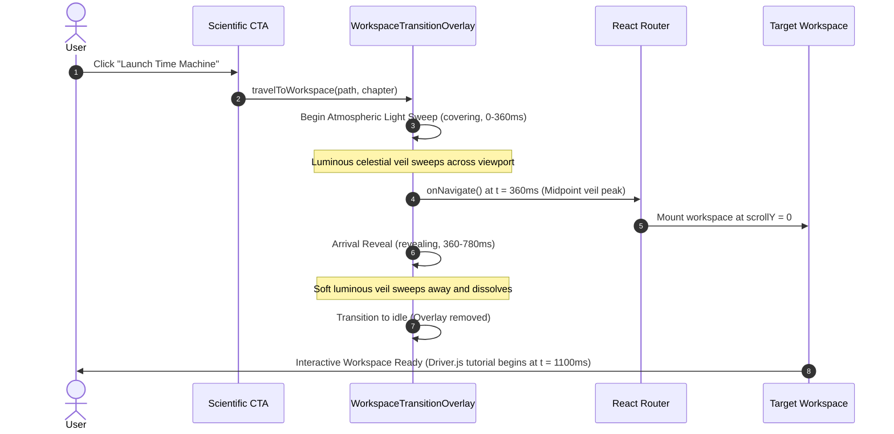

# SPHEREx HORIZON — Journey Transitions & Cinematic Light-Sweep Reveal

## Overview

This document specifies the architecture and verification of the **Cinematic Atmospheric Light-Sweep Reveal** and the complete elimination of end-of-Journey background seams.

---

## 1. Cinematic Light-Sweep Route Transition (`WorkspaceTransitionOverlay.tsx`)

The simulated space-flight star tunnel has been completely replaced by an art-directed atmospheric light-sweep transition:

### Visual Motion & Design Guarantees
- **No Space Tunnel:** Zero flying stars, zero forward/backward zoom, zero camera acceleration, zero distracting star trails.
- **No Decorative Text:** Zero loading headings, zero "WARPING..." badges, zero fake scientific telemetry, zero circular portals.
- **Originating Chapter Color Palettes:**
  - **Home:** Warm golden and copper light (`rgba(244, 162, 114, 0.95)`, accent `rgba(224, 122, 72, 0.65)`).
  - **Explorer:** Deep cosmic indigo and violet light (`rgba(129, 140, 248, 0.95)`, accent `rgba(168, 85, 247, 0.65)`).
  - **Time Machine:** Warm amber and orange light (`rgba(255, 123, 61, 0.95)`, accent `rgba(245, 158, 11, 0.65)`).
  - **Labs:** Restrained neutral graphite and cool-white light (`rgba(148, 163, 184, 0.95)`, accent `rgba(203, 213, 225, 0.65)`).
  - **Mission:** Midnight blue with soft golden light (`rgba(59, 130, 246, 0.95)`, accent `rgba(244, 162, 114, 0.65)`).
- **Complementary Return Sequence:** "Back to Journey" executes a complementary reverse light sweep, restoring the exact originating chapter and vertical scroll position under the veil with zero flash of Home.
- **Tutorial Coordination:** Automatic Driver.js tutorials wait 1100ms after route mounting, ensuring the transition overlay has completely dissolved before onboarding popovers appear.

---

## 2. Elimination of End-of-Journey Background Seams

### Root Cause Analysis
1. **Redundant Transition Pseudo-Element:** A legacy `.labs-to-mission-transition::after` element had a `radial-gradient(ellipse 70% 80% at 50% 100%, ...)` placed at the bottom edge (`bottom: 0`) inside an `overflow: hidden` container. Because the gradient center was at `y = 100%`, it terminated abruptly at the bottom boundary, creating a hard horizontal contrast line.
2. **Backdrop Bottom-of-Page Interpolation:** Previously, `Backdrop.tsx` compared `vCenter` (viewport center) solely against chapter centers. Because the document ends right after `#mission`, `#mission`'s center never reaches `vCenter`, causing the Mission atmospheric layer to stall at ~0.77 opacity with Labs layer remaining at ~0.23 opacity.

### Resolution
- Purged `.labs-to-mission-transition::after` from `cinematic.css` and removed the redundant transition container from `JourneyPage.tsx`. The flowing `LabsToMissionRibbon` now sits directly on the continuous cosmic atmosphere.
- Updated `Backdrop.tsx` with smooth end-of-page scroll progress calculation, guaranteeing that as the user approaches the end of the Journey, the atmosphere smoothly and completely settles into the rich Mission environment (`weights[4] = 1.0`, `weights[3] = 0.0`).

---

## 3. Mission Celestial Destination Atlas & Button Sizing

- **Atlas Layout:** Organized into 4 clearly separated visual regions: compact header, unobstructed celestial map (NO overlapping card), target-selection chips, and a separate target information area below.
- **Scientific Label Accuracy:** Corrected the description of Barnard's Star to explicitly distinguish the predicted catalogue displacement ($10.223''$ over the 359-day baseline) from the annual proper motion rate ($\mu = 10.39''/\text{yr}$).
- **Coordinated Button Sizing:** Both "Begin Your Mission" and "Play Mini Game" have identical dimensions ($56\text{px}$ height, `h-14`, font-size $14\text{px}$, font-weight $600$, border-radius $16\text{px}$).
